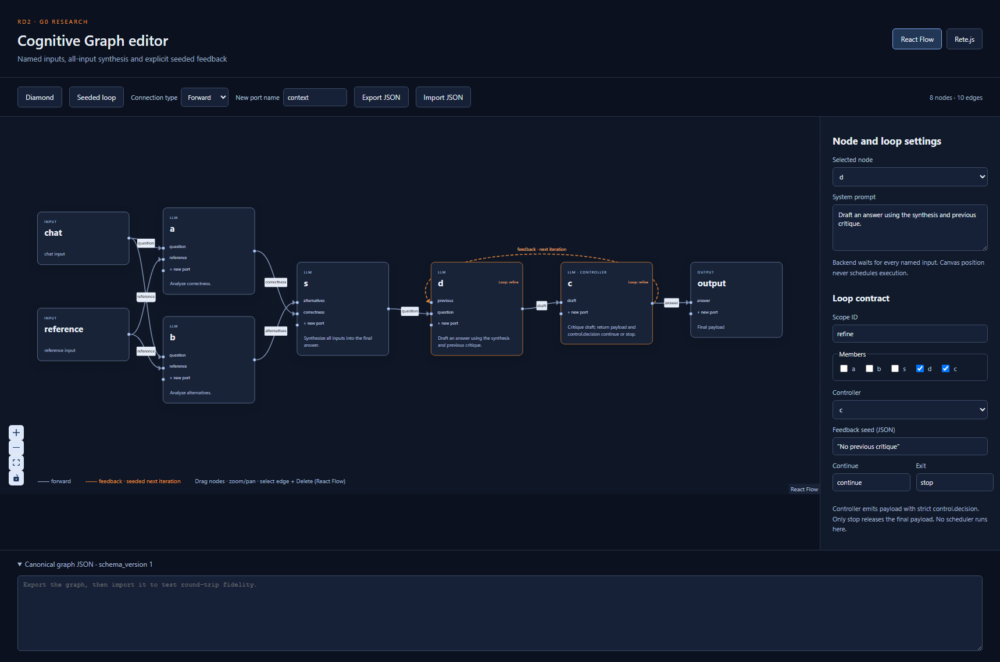

# RD2: graph editor comparison

Date: 2026-10-03. Owner: `coding_rd2`, G0-research, Wave 0.
Authority: [MVP specification](../../Cognitive_Graph_MVP_Codex_Team.md), sections 5, 6.2, 8 and 11/RD2; [durable design](../../.codex/specs/cognitive-graph-mvp/design.md).

Recommend `@xyflow/react` **12.12.0** for the MVP editor. Both actual React canvases render and edit the same canonical graph in `experiments/editor`; React Flow needs fewer adapters and directly accepts controlled JSON node/edge data. This is an RD2 selection proposal for the coordinator to accept in the authoritative `decisions.md`, not a production implementation or independent review verdict.

## Reproduce

Run from the repository root with Node **24.14.0** and npm **11.9.0**:

```powershell
# Needed on this Windows host for npm TLS verification through the installed system CA.
# This applies only to this shell; it does not disable certificate verification.
$env:NODE_OPTIONS = '--use-system-ca'
npm --prefix experiments/editor ci
npm --prefix experiments/editor run typecheck
npm --prefix experiments/editor test
npm --prefix experiments/editor run build
npm --prefix experiments/editor run test:e2e
npm --prefix experiments/editor run dev
```

Open `http://127.0.0.1:5178`. `React Flow` and `Rete.js` select real library canvases with the same graph. `Diamond` loads two named inputs feeding both experts, then synthesis. `Seeded loop` adds draft/critique with a seeded feedback edge, scope membership and controller. Node selection exposes its prompt; graph JSON can be exported, edited and imported without library-specific state.

To add an edge, enter a new port name and drag a payload handle/socket to `+ new port` (React Flow) or `extra` (Rete). Select `Feedback` before drawing a feedback arc. The side panel requires scope, members, controller, JSON seed and distinct continue/exit values; the edge is absent from export until `Commit feedback`. Explicit `null` is a valid seed. React Flow edge selection followed by `Delete` removes an edge. Both canvases support node movement, zoom and pan.

Playwright **1.61.1** uses already-cached Chromium/headless shell revision **1228**, browser **149.0.7827.55**. No browser download or Playwright MCP enablement was required. On a clean machine, the package-local pinned browser install is:

```powershell
npm --prefix experiments/editor run browser:install
```

That clean-machine install command is supplied for reproducibility; it was **not executed** on this host. E2E starts and stops its own loopback Vite server, uses one worker, no retries, 30-second tests and 7-second assertion bounds. Keep port 5178 free before running it. Manual `dev` remains active until stopped by its caller.

## Pins and license evidence

Every direct dependency has an exact version; `package-lock.json` records exact transitive versions and tarball integrity. No global dependency install, unbounded install command, auto-layout dependency or frontend execution engine is used.

| Package | Pin | Purpose / license |
| --- | --- | --- |
| `@xyflow/react` | 12.12.0 | Candidate A; MIT |
| `rete` | 2.0.6 | Candidate B graph objects; MIT |
| `rete-area-plugin` | 2.3.2 | Rete positioning/pan/zoom; MIT |
| `rete-connection-plugin` | 2.0.5 | Rete interactive sockets; MIT |
| `rete-react-plugin` | 2.1.2 | Rete React rendering; MIT |
| `rete-render-utils` | 2.0.3 | Required Rete renderer support; MIT |
| `styled-components` | 6.5.3 | Rete classic styling; MIT |
| `react`, `react-dom` | 18.3.1 each | Shared comparison runtime; MIT |
| `@types/react`, `@types/react-dom` | 18.3.31 / 18.3.7 | React declarations; MIT |
| `@types/stylis` | 4.2.7 | Required styled-components declarations; MIT |
| `@types/node` | 24.10.0 | Test/config declarations; MIT |
| `typescript` | 5.9.3 | Strict checker with library checking enabled; Apache-2.0 |
| `vite` | 8.3.2 | Local server and production bundle; MIT |
| `vitest` | 5.0.3 | Graph-data tests; MIT |
| `@playwright/test` | 1.61.1 | Cached-browser UI E2E; Apache-2.0 |

Verified current official documentation at installation on 2026-10-03: [React Flow quick start](https://reactflow.dev/learn), [multiple custom handles](https://reactflow.dev/learn/customization/handles), [custom edges](https://reactflow.dev/learn/customization/custom-edges), [save/restore](https://reactflow.dev/examples/interaction/save-and-restore), [Rete basic editor](https://retejs.org/docs/guides/basic/), [React renderer](https://retejs.org/docs/guides/renderers/react/), [Rete import/export](https://retejs.org/docs/guides/import-export/).

Exact-version npm metadata reported MIT for both editor candidates. React Flow ships a local `node_modules/@xyflow/react/LICENSE`, matching the [official xyflow license](https://github.com/xyflow/xyflow/blob/main/LICENSE). Rete's npm tarball omits LICENSE, so its [license at npm gitHead e88b43a2ae71e5fda5037add576c259f81759f2f](https://github.com/retejs/rete/blob/e88b43a2ae71e5fda5037add576c259f81759f2f/LICENSE) was inspected. The [React plugin license at npm gitHead e7c283e20db984be200a541ae8ff56e9a216d02a](https://github.com/retejs/react-plugin/blob/e7c283e20db984be200a541ae8ff56e9a216d02a/LICENSE) is also MIT. Both are compatible with an open project when their attribution/license obligations are retained.

Metadata commands used (all exit 0 after enabling the system CA):

```powershell
npm view @xyflow/react@12.12.0 version license repository.url dist.integrity gitHead --json --fetch-timeout=15000 --fetch-retries=0
npm view rete@2.0.6 version license repository.url dist.integrity gitHead --json --fetch-timeout=15000 --fetch-retries=0
npm view rete-react-plugin@2.1.2 version license gitHead --json --fetch-timeout=15000 --fetch-retries=0
npm --prefix experiments/editor ls --depth=0
```

The lockfile SHA256 is `058006972d96f330a17318b1cc21f16659819d7d7514f5eb1a8d9d970466d71f`.

## Executable comparison

| RD2 criterion | React Flow 12.12.0 | Rete 2.0.6 + React plugin 2.1.2 |
| --- | --- | --- |
| OSS React/TypeScript canvas | Verified; one editor dependency, custom node/edge components | Verified; core plus area, connection, rendering and styling packages |
| Named inputs / many-to-many | `targetHandle` stores canonical `target_port`; source fans out | Classic sockets named by canonical port; output `multipleConnections=true`, input false |
| Diamond synthesis structure | Two experts converge into separate `alternatives` and `correctness` handles | Same graph/sockets; no dataflow engine loaded |
| Feedback / cycles | Custom orange dashed Bezier arc; cycles allowed because no generic DAG-only connection veto is installed | Orange dashed connection with `isLoop`; cyclic graph accepted by editor without engine |
| Loop membership / controller / seed / exit | Custom badges, side panel and pending-feedback commit flow | Same domain side panel; membership/controller labels on actual Rete nodes |
| Prompt edit | Node selection + controlled textarea | Same panel plus native `ClassicPreset.InputControl`, both tested |
| Coordinates / JSON round-trip | Canonical projection + controlled node/edge changes; measured geometry excluded from export | Reconstruct classes/sockets/controls from canonical graph; `nodedragged` exports positions |
| Integration complexity | React state remains authoritative; a projection maps canonical fields | Imperative editor lifecycle plus asynchronous recreation/position updates and plugin events |
| License / paid features | MIT; no Pro-only feature required | MIT; no paid feature required |

The fixture has six nodes/seven edges in diamond mode and eight nodes/ten edges with the refinement loop. `chat` and `reference` each feed both experts, proving multiple named inputs and many-to-many topology. `d` and `c` belong to `refine`; `c` is the controller, `c → d:previous` is feedback with `initial_value`, and only controller `c` connects to output. Defaults use explicit coordinates; ELK/dagre are unnecessary.



Screenshot generated by the pinned E2E suite and visually inspected at 1720×1120. Screenshot SHA256: `054d3750038bdbf159cffb2efcd6ce4dce5972dd71dc9d108971105d8d2a627e`.

## Verification evidence and coverage

Final verification on 2026-10-03:

| Exact command | Exit | Result / evidence |
| --- | --- | --- |
| `npm --prefix experiments/editor ci` | 0 | Clean reinstall from lock; 87 packages; npm reported zero vulnerabilities |
| `npm --prefix experiments/editor run typecheck` | 0 | TypeScript strict, `skipLibCheck=false`, including both adapters and E2E/config |
| `npm --prefix experiments/editor test` | 0 | Six graph-data tests |
| `npm --prefix experiments/editor run build` | 0 | Production Vite build with both library canvases |
| `npm --prefix experiments/editor run test:e2e` | 0 | Six actual Chromium UI scenarios, one worker, no retries |
| `npm --prefix experiments/editor ls --depth=0` | 0 | All installed direct pins match manifest |

Unit coverage: diamond/named providers and fan-out; conflicting target providers; exact prompts, coordinates, feedback/loop JSON round-trip; explicit null seed versus omitted seed, missing scope membership, wrong controller; malformed JSON/unknown endpoints/version; immutable prompt edit.

Browser coverage: rendered feedback and named handles; prompt/null-seed/exit edits; exact export/import after replacing the canvas fixture; interactive React Flow connection, moved positions and deletion; pending feedback requires explicit settings before commit; Rete real nodes/sockets/feedback SVG, native prompt edit, JSON fidelity; native Rete connection and moved coordinates; reproducible screenshot. Tests inspect canonical graph values and actual rendered edges rather than only mounting a component.

Failure evidence preserved in this account: initial test-first unit command exited 1 because the graph module had not yet been implemented. Initial strict typecheck exited 1 on Rete's global `JSX` declaration with React 19 and absent stylis declarations. React 18.3.1 plus explicit type dependency solved those errors without `skipLibCheck`. Initial UI run exited 1 (four failed, one passed): unnecessary initial controlled-node resynchronization erased measured handle geometry. Removing that resynchronization and preserving canvas measurements fixed rendering. A second UI run exited 1 (one failed, four passed) because controlled edge selection was not retained for deletion; adding controlled edge change handling fixed it. Final suite includes strengthened Rete interactions and passes all six.

Non-blocking observed warnings: Vite reports that `use client` from React Flow may not survive bundling; this is a standalone browser app with no server-component boundary. React Flow emits a transient missing-handle warning in the frame where a newly named port and edge are first projected; the tests wait for and verify the resulting edge. Package output also reports host `NO_COLOR`/`FORCE_COLOR` precedence. No browser runtime exception was observed in the checked scenarios.

## ADR proposal: select React Flow for the MVP

**Status:** proposed; coordinator records acceptance in the authoritative [decisions](../../.codex/specs/cognitive-graph-mvp/decisions.md).

**Decision:** use exact `@xyflow/react@12.12.0` as a visual editor only. Keep canonical graph JSON, backend-generated schema/types, loop scopes, named ports and backend validator as product contracts. Do not use frontend graph evaluation to define R04 fan-in or R05 loop semantics.

**Why:** actual UI tests show that one React Flow package supports all RD2 canvas requirements. React props/state naturally represent versioned files and immutable run-snapshot references. Its smaller integration surface is preferable for the minimal React UI. Rete can meet the requirements, but its class/socket import reconstruction and plugin lifecycle add code without delivering an MVP capability missing from React Flow. Its React 19 typing mismatch is another integration cost observed in this experiment, rather than an unsupported assumption from documentation.

**Consequences:** loop membership/controller/seed/exit remain product UI controls, not editor-library features. Backend schema validation must reject invalid DAG/SCC/controller/output configurations regardless of the drawing. Production must avoid resetting measured handle state during edits and call `useUpdateNodeInternals` after dynamic port changes. Production dependencies are owned by the G1 bootstrap owner; the research React 18 pin is a compatibility choice for this comparison, not an implicit product React version requirement.

**Reversibility:** both adapters already consume the same canonical JSON. Replacing the visual editor preserves graph files, run snapshots and scheduler contracts. Revisit only if later approved UI requirements expose a capability gap or maintenance constraint.

## Limits and handoff

RD2 is verified locally; no RD2 blocker remains. Independent G0 review/selection consolidation is still owned by the coordinator. This research does not close A03–A06 runtime semantics, A12 full production CRUD/publication/history/persistence, or Hermes/Ollama/Compose live gates. It does not claim scheduler or LLM behavior from a drawing.

The experiment deliberately has no backend, storage API, executor, publication, account system or layout engine. Import guards check editor fidelity and several feedback invariants, not the complete production schema, path allowlist, reachability, SCC or output-bypass rules. `base_model=USER_INSTALLED_MODEL` is inert fixture data; no model is invoked. The Rete prototype rebuilds its imperative canvas on canonical edits, which is adequate for short R&D but would need incremental reconciliation in production. React Flow edge deletion is demonstrated; Rete deletion parity is not required to choose the simpler candidate and is not claimed. Large-graph performance, touch and screen-reader behavior were not measured.

Only the delegated `experiments/editor` source/config/manifest/lock files and this report/screenshot changed. Package artifacts (`node_modules`, `dist`, `test-results`) are derived. No global configuration, external MCP server, approval setting, shared contract, product bootstrap, secret, Git history or peer file was changed.
